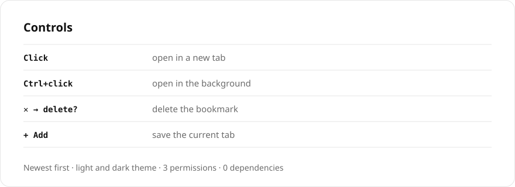

[Русский](README.md) · **English**

 

 

## Install

1. Download the [ZIP](https://github.com/sailxx/Marks/archive/refs/heads/main.zip) and unpack it.
2. Open `brave://extensions` and turn on Developer mode.
3. "Load unpacked" → the folder with `manifest.json`.

Permissions: `bookmarks` — bookmarks, `activeTab` — current tab for the form, `favicon` — site icons.
