[Русский](README.md) · **English**

 

 

Brave's built-in bookmark manager is a separate page with a folder tree. **Marks** is one click on the toolbar icon, and all your bookmarks are right there: open, add the current tab, delete. No loud colors, no extra features.

 

<b>Controls</b>

| Action | Result |
|---|---|
| **Click** a bookmark | Open in a new tab |
| **Ctrl+click** or **middle click** | Open in the background |
| **✕** on hover → **delete?** | Delete the bookmark |
| **+ Add** at the bottom | Form with the current tab's title and URL, folder picker |

 

## Install

1. Download the [ZIP](https://github.com/sailxx/Marks/archive/refs/heads/main.zip) and unpack it to a permanent folder.
2. Open `brave://extensions` (or `chrome://extensions`) and turn on Developer mode.
3. Click "Load unpacked" and select the folder with `manifest.json`.
4. Pin Marks to the toolbar via the puzzle icon.

Permissions: `bookmarks` — read and edit bookmarks, `activeTab` — prefill the form with the current tab, `favicon` — show site icons.
