**Русский** · [English](README.en.md)

 

 

Встроенный менеджер закладок Brave — отдельная страница с деревом папок. **Marks** — один клик по иконке на панели, и все закладки перед вами: открыть, добавить текущую вкладку, удалить. Без ярких плашек и лишних функций.

 

<b>Управление</b>

| Действие | Результат |
|---|---|
| **Клик** по закладке | Открыть в новой вкладке |
| **Ctrl+клик** или **колёсико** | Открыть в фоне |
| **✕** при наведении → **удалить?** | Удалить закладку |
| **+ Добавить** внизу | Форма с названием и адресом текущей вкладки, выбор папки |

 

## Установка

1. Скачайте [ZIP](https://github.com/sailxx/Marks/archive/refs/heads/main.zip) и распакуйте в постоянную папку.
2. Откройте `brave://extensions` (или `chrome://extensions`) и включите «Режим разработчика».
3. Нажмите «Загрузить распакованное» и выберите папку с `manifest.json`.
4. Закрепите Marks на панели через значок пазла.

Разрешения: `bookmarks` — читать и менять закладки, `activeTab` — подставить текущую вкладку в форму, `favicon` — показать иконки сайтов.
