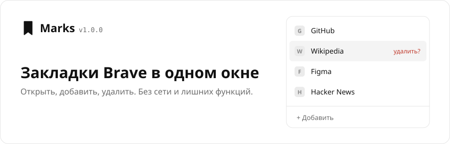
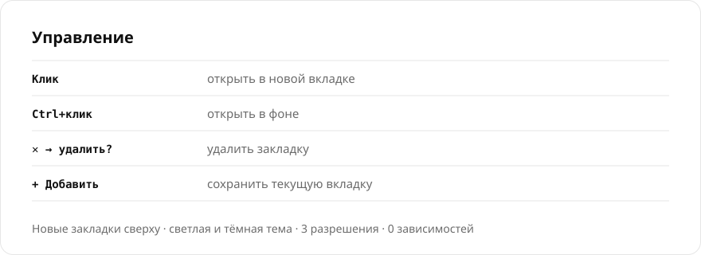

**Русский** · [English](README.md)

 

 

## Установка

1. Скачайте [ZIP](https://github.com/sailxx/Marks/archive/refs/heads/main.zip) и распакуйте.
2. Откройте `brave://extensions` и включите «Режим разработчика».
3. «Загрузить распакованное» → папка с `manifest.json`.

Разрешения: `bookmarks` — закладки, `activeTab` — текущая вкладка для формы, `favicon` — иконки сайтов.
